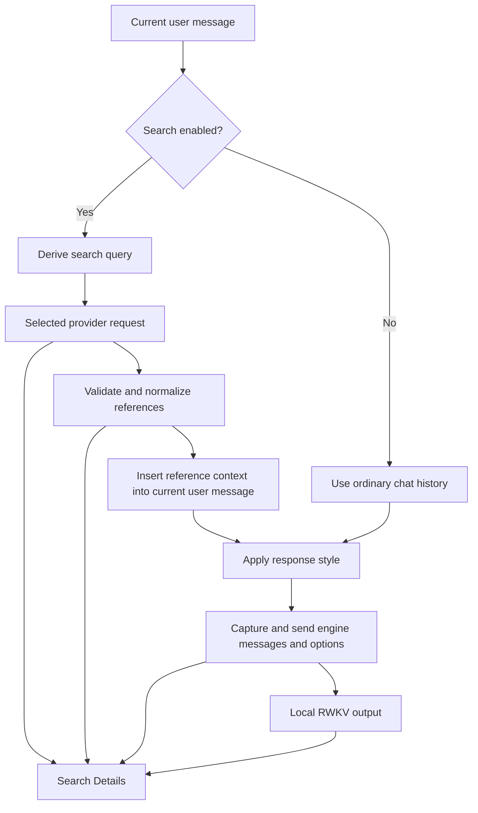

# Chat Search Data Flow and Diagnostics

The canonical product contract is `SPEC-RWKV-CHAT-SEARCH` in
[the Specification](../specification.md). This document maps that contract to
the implementation and explains the data shown in Search Details.

## Orchestration boundary

The App orchestrates search before local answer generation. The user selects a
provider or turns search off in the chat input controls. With search enabled,
the App derives a query, calls the selected search service, and inserts the
retrieved references into the local model's message history.

The local RWKV model receives reference text and the user's question. This
workflow does not ask the model to choose a provider, emit a tool call, operate
HTTP, or manage API credentials. Search does not call a provider's chat model.
Correct retrieval and a well-formed prompt do not establish answer accuracy.



## Query derivation and search request

`P.chat._historyWithWebSearchResult` takes the latest user message from the
ordinary chat history. `splitWebSearchPrompt` separates one configured
thinking-mode footer from the end of that message. A matching marker written
by the user before that suffix remains in the user text.

For API search, `buildWebSearchApiQuery` preserves the trimmed current question
when it fits the provider limit: 128 Unicode code points for DeepSeek, 100 for
other providers. It must not add an unrequested scope such as registered dogs.
Overlong questions use the existing bounded `SearchQueryGenerator` with only
the current message. Earlier conversation messages are not transmitted to the
search provider. The effective query is recorded separately from the original
user question.

The request is built once in `lib/func/web_search_api.dart`. The same request
object supplies the credential-free diagnostic snapshot before it is sent.
The snapshot keeps the method, URL, non-credential query parameters, request
body, and allowlisted content-type or request-timestamp headers. Authentication
headers and credential query parameters are omitted. A configured key is also
redacted if it appears in diagnostic content.

The API provider endpoints are fixed by `WebSearchProvider.endpoint`:

| Provider | HTTPS endpoint |
| --- | --- |
| AnySearch | `https://api.anysearch.com/v1/search` |
| DeepSeek Search | `https://api.deepseek.com/v1/tools/search` |
| Zhihu Web | `https://developer.zhihu.com/api/v1/content/global_search` |
| Zhihu Site | `https://developer.zhihu.com/api/v1/content/zhihu_search` |
| Tavily | `https://api.tavily.com/search` |
| Brave Search | `https://api.search.brave.com/res/v1/web/search` |
| Exa | `https://api.exa.ai/search` |
| Serper | `https://google.serper.dev/search` |
| SerpApi | `https://serpapi.com/search.json` |
| SearchApi | `https://www.searchapi.io/api/v1/search` |
| Firecrawl | `https://api.firecrawl.dev/v2/search` |

HTTP redirects are disabled. Credentials go only to the selected fixed origin.
The SerpApi request includes an API key in a query parameter; the diagnostic
snapshot explicitly removes that parameter. The snapshot is intentionally not
a replayable authenticated request.

Desktop Browser search uses the existing `local_web_search` browser path and
records its search URL. Its browser page processing and source limit are
separate from the API path described below. Mobile API search does not need
an embedded browser.

## Results retained by the App

The API client reads at most 1 MiB, with a 20-second request timeout. It rejects
unsupported status codes, invalid response structures, invalid result URLs,
and responses echoing the configured credential. Titles, URLs and excerpts
are mapped into `Reference` objects.

The API normalizer examines at most the first 20 result entries, removes
duplicate URLs, and retains at most three references. Titles are limited to
300 Unicode code points and excerpts to 2,000. Accepted URLs use HTTP or HTTPS,
have a host, and do not contain URL user information. Reference order determines
the one-based citation numbers.

Details persists the complete bounded UTF-8 API response body and HTTP status
before normalization. The preview and complete-response panel use this captured
body; copying does not apply preview or reference limits. Credential values are
redacted while other response text and whitespace are preserved. Oversized or
invalid UTF-8 bodies are not stored as complete responses. Legacy and Browser
search records without an API response identify that absence and show only
saved references. Normalized references remain separate and retain citation order.

`webSearchApiContext` formats references as readable Chinese or English text,
matching the current prompt language. It retains the untrusted-source boundary,
numbered citation instruction and the distinction between historical/partial
statistics and current totals:

```text
<Reference and evidence-sufficiency instructions>

[1] <Source title>
URL: <Source URL>
Excerpt: <Source excerpt>
```

The angle-bracket entries above describe the format. An actual report must
contain the captured reference data, without substituting this example.

## Prompt construction

The default wrapper is defined in `lib/func/web_search_prompt.dart` and used by
`PromptTemplate.empty()`. It places the original current question once, the
current local calendar date, numbered references, then four short requirements
for direct cited answers, numeric scope, historical dates and insufficient
evidence. The provider's explicit structured publication date is retained in
`Reference.publishedAt` and `WebSearchTraceSource.publishedAt`; unknown dates
are omitted and are never inferred from a title, summary or search time.

The shared builder passes context, question and current date as positional
sprintf arguments. Exact one-newline and two-newline legacy defaults resolve
to the new wrapper at use time. Custom templates retain their existing content
and argument order, including the earlier blank-line behavior. The configured
thinking footer is separated before search and appended once after expansion.
Default API context contains reference data only; custom templates retain the
legacy untrusted-source/citation context. Browser search retains its existing
full context and deep-result selection.

## Engine request capture

After search injection and response-style processing,
`P.rwkvGeneration.sendMessages` constructs the real `ChatAsync` or
`ChatBatchAsync` request. Immediately before bridge dispatch,
`P.chat.onWebSearchModelRequest` records that request for the associated
generating chat reply. It ignores settled messages, other demo types, and the
prefill-only `maxLength == 0` path.

`webSearchModelRequest` copies the ordered messages and request fields:

| Field | Meaning |
| --- | --- |
| `type` | `ChatAsync` or `ChatBatchAsync` |
| `requestId` | Correlation ID of the actual bridge request |
| `messages` | Complete ordered request messages; nested by slot for a batch |
| `modelID` | Runtime model selected for the request |
| `enableReasoning`, `forceReasoning` | Actual request reasoning flags |
| `addGenerationPrompt` | Actual request generation-prefix flag |
| `forceLang` | Per-request language option |
| `maxLength` | Explicit request override, or `null` to use the adapter default |
| `batchSize`, `forceLangs`, `slotConfigs` | Batch-specific settings when present |

Retain the actual request fields without adding capture timestamps, configured
length/decode snapshots, or synthetic capture flags. A `null` request
`maxLength` means that the adapter resolves its active default; it is not zero
or unlimited output. Generation settings and request identifiers are not prompt
text and are not rendered in the final-model-input section.

`modelInput.requests` appends subsequent requests for a reply, such as
sequential style routes or resumed generation. The captured lists are copied
so later mutations of a caller's list cannot change recorded messages.

This feature captures the complete engine request payload. It does not capture
the native runtime's internal chat-template serialization, system-prefix
state, tokenized input bytes, cached-prefix execution, or logits. Do not label
the legacy `finalPrompt` string, or a manually reconstructed role template, as
the complete native prompt.

## Details, copying and persistence

Search Details has four numbered sections:

1. **Search request**: provider, original question, effective query, safe request
   snapshot and search error when present
2. **Search results**: normalized references in citation order and the reference
   context used for prompt construction
3. **Final model input**: the actual message text in send order, including
   history and the final search/style-enhanced user message. Do not add
   translated user/assistant prefixes that were never in captured messages.
   Group calls or parallel conversations only when multiple ones exist
4. **Model output**: content read directly from the associated `Message`.
   Generating, paused, finished and empty state captions stay outside raw text

`WebSearchTracePanel` receives the reply's message ID and watches its entry in
`P.msg.pool`. Output updates while generation is active. Removing the message
shows unavailable output and disables copying from that detached view.

The pure formatter in `lib/func/web_search_report.dart` supplies the same four
sections for rendering, per-section copying, and complete Markdown copying.
Per-section copying returns the section body directly, without report headings
or Markdown fences. Complete-report copying keeps all four numbered sections;
output state captions sit outside the raw-output fence.
The input section reads only actual `messages` from captured requests, including
older envelopes with diagnostic fields, and does not serialize that envelope
as JSON or repeat an already included injected message. A one-message request
renders exactly that message. When actual messages are missing, show the missing
capture notice and any saved injected message as partial evidence.
It preserves whitespace and Unicode. Markdown fences grow when captured text
contains backticks, and configured credentials are redacted in raw, URL-encoded
and JSON representations. Copying does not change the actual engine request or
the stored assistant content.

The trace is serialized inside `Message.reference` through `RefInfo`, using
the existing message database path. New fields have empty defaults for old
records. The actual output stays in `Message.content`; no second output copy
is stored in the trace. Reopening a saved reply does not repeat its search.

Historic replies without a request or complete engine-input capture explicitly
say that those snapshots were not recorded. A saved injected user message can
still be shown as partial evidence. A missing capture must not be synthesized
from current settings and presented as an exact past request.

For older saved replies with references and no trace object at all,
`webSearchTraceForReport` supplies a view of only their retained references and
error. Details remains available, and output still comes from the associated
message. The fallback leaves query, HTTP request and model-input captures
empty; it does not write a reconstructed trace back to the conversation.

Search reference state is updated before inference-request capture. A delayed old
reference update must not overwrite a newer captured engine request.

## Security and failure boundaries

- Personal API keys remain in platform secure storage after successful
  verification. Do not add shared or bundled test credentials
- Credentials are excluded from trace storage, logs, clipboard reports and
  delivery artifacts. Reports redact configured credentials while inference
  retains its real input
- Empty results and failures use the existing localized failure mapping. The
  HTTP client maps 401/403 to authentication failure, 402 to balance failure,
  and 429 to a provider-limit/rate-limit failure; timeout and schema failures
  have their own states. Do not infer a precise quota, balance or expiry date
  from a generic provider error
- Failure reports keep the safe request and capture status. A failure before
  request construction may legitimately have no HTTP request snapshot
- Opening Details, viewing sources and copying reports do not make another
  search request
- Full messages may contain user conversation content. Use a fresh public test
  conversation for shared evidence and review the exported report before sharing

## Code map

| Concern | Primary files |
| --- | --- |
| Search choice and settings | `lib/widgets/chat/web_search_mode_button.dart`, `web_search_provider_sheet.dart`, `web_search_settings_panel.dart` |
| Provider endpoints | `lib/model/web_search_provider.dart` |
| Personal credential vault | `lib/func/web_search_credentials.dart` |
| API request, safe request snapshot, normalization | `lib/func/web_search_api.dart` |
| Search query generation | `packages/local_web_search/lib/src/query/search_query_generator.dart` |
| Thinking-footer separation | `lib/func/web_search_prompt.dart` |
| Search orchestration and prompt insertion | `lib/store/chat_web_search.dart` |
| Search template defaults | `lib/model/prompt_template.dart` |
| Chat send and response-style routing | `lib/store/chat_input_send.dart`, `chat_response_style.dart` |
| Final request construction and capture hook | `lib/store/rwkv_generation.dart` |
| Engine request serialization for diagnostics | `lib/func/web_search_model_input.dart` |
| Persisted search trace and references | `lib/model/web_search_trace.dart`, `ref_info.dart`, `message.dart` |
| Four-stage formatting and credential redaction | `lib/func/web_search_report.dart` |
| Details and message association | `lib/widgets/chat/web_search_trace_panel.dart`, `reference_info.dart`, `lib/widgets/message.dart` |

## Verification

Use the repository's pinned SDK wrapper so CLI and IDE use the same Flutter
and Dart versions. The Specification checker belongs to the separate `tools`
package. Prepare that package's dependencies with the pinned SDK before
checking, so `tools/.dart_tool/package_config.json` exists. Its generic Dart
invocation is
`dart --packages=tools/.dart_tool/package_config.json run tools/bin/check_specification.dart`;
`dart` must resolve to the intended SDK. The equivalent pinned-wrapper command
is shown below:

```bash
node tools/check_flutter_toolchain.mjs
node tools/flutter.mjs --dart --packages=tools/.dart_tool/package_config.json run tools/bin/check_specification.dart
node tools/flutter.mjs test --no-pub test/web_search_trace_capture_test.dart test/web_search_report_test.dart test/web_search_trace_panel_test.dart test/ref_info_test.dart test/web_search_prompt_test.dart test/search_reference_test.dart
node tools/flutter.mjs test --no-pub test/chat_history_test.dart test/get_batch_info_test.dart test/msg_node_test.dart test/message_thinking_preview_test.dart
```

These checks establish mechanical behavior. App-level acceptance additionally
requires a visible run in the canonical RWKV Chat App, using its normal chat
input, selected provider, loaded model, Details view and copy controls. Inspect
the copied request, sources, engine messages and model output from the same
reply. Do not replace this with a hidden runner, direct store invocation,
direct inference-engine request, a renamed App, or a different persistence
namespace.

Independent examples use a fresh chat without prior messages. Ordinary chat history
remains intact for conversational follow-ups; do not remove actual historic input
from an old trace and claim it was an independent run.

The request frame contains only the effective query. Provider and HTTP metadata
are outside it; complete-report copy also includes the safe request snapshot.
Results preview the captured response and offer a complete-response panel.
Fixed explanations and generation states stay outside raw content. Reply source
tags use the saved reference order to open a safe HTTP(S) source URL and display
its title/URL on hover. Rendering does not rewrite stored model output.
